AI/ML Engineer · I build agent runtimes, the sandboxes they run in, and the evals that keep them honest

 

**Agents**&nbsp;&nbsp;
      

**Training**&nbsp;&nbsp;
       

**MLOps**&nbsp;&nbsp;
     

**Backend**&nbsp;&nbsp;
    

 

### Featured projects

| Project | What it does |
| :-- | :-- |
| [`diwan`](https://github.com/Zine-Elabidine/diwan) | Agent runtime built from the loop up: tool calling, approvals, an append-only tree log of every session, model switching mid-conversation. |
| [`tarjuman`](https://github.com/Zine-Elabidine/tarjuman) | One neutral message format for OpenAI and Anthropic APIs: switch models mid-conversation without losing tool calls or reasoning. |
| [`nl2sql`](https://github.com/Zine-Elabidine/nl2sql) | Text-to-SQL on BIRD: SFT → GRPO fine-tuning vs. self-consistency, 63.7% execution accuracy. Voting beat fine-tuning. |
| [`telepathy`](https://github.com/Zine-Elabidine/telepathy) | Coding-agent memory on every machine: memory bundles chosen per project, synced through git. |
| [`research‑mcp`](https://github.com/Zine-Elabidine/research-mcp) | MCP server that federates web, community and demand search for agents. |

Also: [CVRPTW with RL](https://github.com/Zine-Elabidine/CVRPTW-with-Reinforcement-learning-Dynamic-Attention-Mechanisms) · [Transformer from scratch](https://github.com/Zine-Elabidine/Transformer-from-scratch) · [Positional encodings](https://github.com/Zine-Elabidine/Positional-Encodings-Overview) · [PEFT methods](https://github.com/Zine-Elabidine/PEFT-Methods) · [Seq2seq translation](https://github.com/Zine-Elabidine/Seq2Seq-machine-Translation-Models) · [RAG with Llama 2](https://github.com/Zine-Elabidine/RAG-with-Llama-v2) · [Fast style transfer](https://github.com/Zine-Elabidine/Fast-Style-Transfer) · [Time series](https://github.com/Zine-Elabidine/2018-Index-Time-series-analysis)

 

